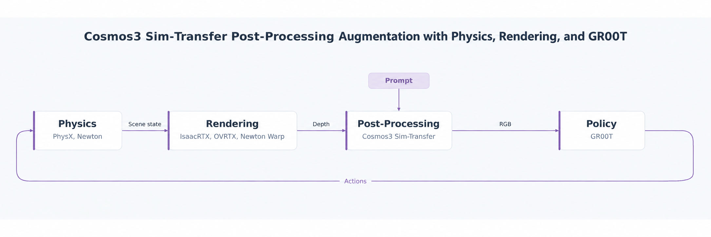

# Cosmos Transfer apple pick-and-place demo

Run a GR00T N1.7 policy on a Unitree G1 with Dex3 hands that picks an apple and places it
on a plate, with Cosmos3-Nano-Sim-Transfer turning the head camera's depth into the
realistic image the policy was trained on.



Each step, Isaac Lab simulates the scene and renders the head camera's depth. The Cosmos
service generates an RGB image from that depth and a prompt, the GR00T server predicts the
next 16 actions from the image and the robot's joint positions, and Isaac Lab plays them.

The task is `IsaacContrib-PickPlace-Apple-G1-Dex3`. Its scene, start states, prompt and
controller settings follow the calibrated apple demo by Marilyn Reeb. Without `presets=cosmos`
it uses the rendered camera image instead.

This demo runs three processes: the GR00T policy server, the Cosmos service and the Isaac Lab
run. The setup for Cosmos is the same as for the
[Shadow Hand demo](cosmos_transfer.md), including its VRAM needs. Give the GR00T server a
GPU too; the examples put it on GPU 1.

For service options and camera configuration, see [Serving Cosmos](cosmos_service.md)
and [Cosmos camera integration](cosmos.md).

## 1. Set paths

Start in a parent directory that will contain `IsaacLab`, `cosmos-framework`,
`gr00t-leapp-export`, and the two model directories. Set these variables before cloning:

```bash
export ISAAC_LAB="${PWD}/IsaacLab"
export COSMOS_FRAMEWORK="${PWD}/cosmos-framework"
export COSMOS_CHECKPOINT="${PWD}/cosmos-model"
export GR00T_ROOT="${PWD}/gr00t-leapp-export"
export GR00T_CHECKPOINT="${PWD}/apple-policy"
```

In each new terminal, set the same variables to those absolute paths before changing
directories.

## 2. Clone the repositories

Clone Isaac Lab, Cosmos Framework, and the GR00T runtime at the revision the policy was
tested with. GR00T uses git submodules:

```bash
git clone https://github.com/isaac-sim/IsaacLab.git "$ISAAC_LAB"
git clone https://github.com/NVIDIA/cosmos-framework.git "$COSMOS_FRAMEWORK"
git clone --recurse-submodules https://github.com/nvidia-isaac/gr00t-leapp-export "$GR00T_ROOT"
git -C "$GR00T_ROOT" checkout 072c98dcdc5acf471aabb0e4df1b256da8608831
git -C "$GR00T_ROOT" submodule update --init --recursive
```

## 3. Install dependencies and download the checkpoints

Install the Cosmos environment and checkpoint as in
[Cosmos Transfer demo setup, step 3](cosmos_transfer.md#3-install-dependencies-and-download-the-checkpoint).

Install the GR00T environment, which needs Python 3.10, and download the apple policy:

```bash
cd "$GR00T_ROOT"
uv sync --python 3.10 --frozen
uv run hf download nvidia/GR00T-N1.7-AppleToPlate-cosine40k-checkpoint-15000 \
  --local-dir "$GR00T_CHECKPOINT"
```

Keep the GR00T and Isaac Lab environments separate: the simulator never imports GR00T.

## 4. Start the GR00T policy server in terminal 1

```bash
cd "$GR00T_ROOT"
uv run python gr00t/eval/run_gr00t_server.py \
  --embodiment-tag NEW_EMBODIMENT \
  --model-path "$GR00T_CHECKPOINT" \
  --device cuda:1 \
  --port 5555
```

Wait until the server reports that it is ready. Leave this terminal running.

## 5. Run the task in terminal 2

Run the task with the rendered camera image first. It needs only the GR00T server. The task
uses the PhysX backend and RTX rendering, so `--extra isaacsim` installs Isaac Sim; the two
`--with` options add the messaging libraries the client uses. No window opens unless you
select a visualizer with `--viz`. Isaac Sim requires you to accept its
[license agreement](https://docs.omniverse.nvidia.com/platform/latest/common/NVIDIA_Omniverse_License_Agreement.html)
before a headless launch; after reviewing it, set `OMNI_KIT_ACCEPT_EULA=YES`. On a host
without a screen, run `unset DISPLAY` first, or the launch can fail with `GLXBadFBConfig`:

```bash
unset DISPLAY
export OMNI_KIT_ACCEPT_EULA=YES
cd "$ISAAC_LAB"
uv run --extra isaacsim --with msgpack==1.2.3 --with pyzmq==27.2.0 \
  python scripts/imitation_learning/gr00t/play_apple_pick_place.py --num_episodes 4
```

Each finished episode prints `[INFO] Episodes: N, successes: K`. An episode succeeds when the
apple rests on the plate and the hands have let go, and ends after 20 seconds otherwise.

### Without Isaac Sim

The task also runs PhysX without Isaac Sim, through OvPhysX, with the kit-less OVRTX renderer.
`--extra ov` installs both runtimes; no license acceptance or display setup is needed:

```bash
cd "$ISAAC_LAB"
uv run --extra ov --with msgpack==1.2.3 --with pyzmq==27.2.0 \
  python scripts/imitation_learning/gr00t/play_apple_pick_place.py \
  --num_episodes 4 physics=ovphysx renderer=ovrtx
```

Use `renderer=newton_renderer` for the lighter Warp renderer. Add `presets=cosmos` as below to
generate the image with Cosmos. Without `physics=ovphysx` and `renderer=...` the task uses Isaac
Sim PhysX and the Isaac RTX renderer.

## 6. Run with Cosmos

Start the Cosmos service in a third terminal as in
[step 4 of the Shadow Hand setup](cosmos_transfer.md#4-start-the-cosmos-service-in-terminal-1),
wait for `Cosmos ready at ...`, and then add `presets=cosmos`:

```bash
cd "$ISAAC_LAB"
uv run isaaclab cosmos status
uv run --extra isaacsim --with msgpack==1.2.3 --with pyzmq==27.2.0 \
  python scripts/imitation_learning/gr00t/play_apple_pick_place.py --num_episodes 4 presets=cosmos
```

Check for `"ready": true` and `"session_active": false` first. The preset sends the head
camera's depth to the service with the prompt in
`isaaclab_tasks/contrib/apple_pick_place/prompts/apple_pick_place.json`, and the policy
reads the generated image. Edit that file to change the appearance of the scene.

## 7. Optional: save the camera images

Add `--save_frames DIR` to save the head camera image the policy sees as PNG files, one at the
start and then every `--frame_interval` steps (30 by default, one second of simulation):

```bash
uv run --extra ov --with msgpack==1.2.3 --with pyzmq==27.2.0 \
  python scripts/imitation_learning/gr00t/play_apple_pick_place.py \
  --num_episodes 1 --save_frames outputs/apple_cosmos \
  physics=ovphysx renderer=ovrtx presets=cosmos
```

Press Ctrl+C in the Cosmos terminal and the GR00T terminal when finished.
